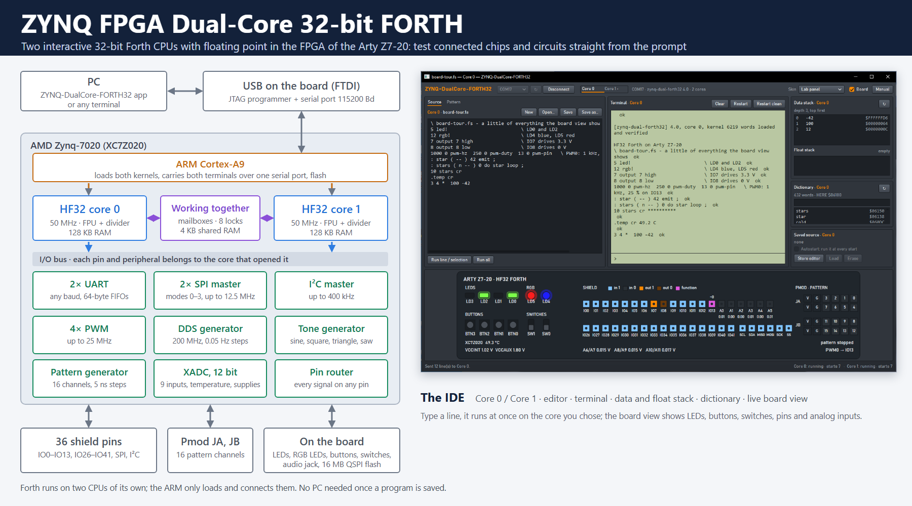

# ZYNQ FPGA Dual-Core 32-bit FORTH

**Two interactive 32-bit Forths with floating point on the Digilent Arty Z7-20**



ZYNQ FPGA Dual-Core 32-bit FORTH puts two complete Forth systems into the FPGA of the AMD
Zynq-7020 on the Digilent Arty Z7-20. Each runs on its own **HF32**, a 32-bit stack machine
that executes one Forth primitive per clock at 50 MHz, with a hardware floating-point unit
(IEEE single precision), a divider and 128 KB of RAM. The two cores work side by side and
together: mailboxes, locks and a shared memory connect them, and every pin and peripheral
belongs to the core that opened it. The Zynq's ARM core only loads both kernels and carries
both terminals over the board's USB serial port; Forth itself runs on its own CPUs, and the
board starts straight into it.

**Why Forth?** Forth is interactive: type a line and it runs at once, with no
compile-and-flash cycle. It is fast, small and easy to learn. That makes it ideal for trying
out and testing chips and circuits connected to the board. Two UARTs, two SPI masters, an I²C
master, four PWM channels and a DDS generator can each be put on any of the 36 shield pins,
and a 16-channel pattern generator plays digital sequences in 5 ns steps on the Pmod headers.
You can talk to a sensor, set up a clock chip or drive a bus in a few typed lines, and work
out the result in floating point on the spot. With two cores, one can run a measurement or a
control loop while you keep typing on the other. One Forth program per core can be saved in
the board's flash, so it runs at every start without a PC.

**IDE included.** The ZYNQ-DualCore-FORTH32 app for Windows switches between the two cores,
each with its own source editor, terminal, data and float stack, dictionary and saved
program. It also shows a live view of the board (LEDs, buttons, switches, pins, analog
inputs) and edits patterns for the pattern generator as a timing diagram. **Help** (F2)
describes every Forth word, with a search over names, stack effects and descriptions; F1
opens the full user manual.

Open source (MIT): RTL, Forth kernel, cross-compiler, simulator, ARM firmware and app, with a
user manual and implementation details. It continues
[ZYNQ-FPGA-FORTH32](https://github.com/andiepp/ZYNQ-FPGA-FORTH32) (one core); sources written
for it, or for the 16-bit [ZYNQ-FORTH](https://github.com/andiepp/ZYNQ-FORTH), run on either
core. How it was built, step by step: [docs/DualCore-Plan.md](docs/DualCore-Plan.md).

## Features

- **Two HF32 cores**, 32-bit dual-stack CPUs in the Zynq's programmable logic whose
  instructions are Forth primitives: one instruction per clock at 50 MHz, 128 KB of RAM
  each, which the other core cannot reach.
- Per core a **floating-point unit** for IEEE single precision (round to nearest even) with
  its own **float stack** (`f+ f- f*` in 5–6 clocks, `f/ fsqrt` in 31), and a **divider**:
  `um/mod` and `u/mod` in about 20 clocks.
- **Working together**: a 32-cell mailbox in each direction (`send receive mail?`), eight
  locks (`lock try-lock unlock`) and 4 KB of shared memory (`shared`); `core#` tells a
  program where it runs. Pins and peripherals belong to the core that opened them, and
  restarting one core resets only what it held while the other keeps running.
- A **Forth kernel** of 439 words, written in Forth and cross-compiled on the PC: the
  interpreter and compiler, the Forth-2012 floating-point words (literals like `1.5e-3`,
  `f. fs. fe.`, `fsin fcos ftan fatan2 fasin facos fexp fln flog f** fsqrt`…), correctly
  rounded number conversion, the board's LEDs, RGB LEDs, buttons and switches, 36 shield
  pins, 4 PWM channels, 9 analog inputs through the XADC (also in volts as floats), and the
  pattern generator.
- **Serial interfaces on any pin**: 2 UARTs, 2 SPI masters (up to 12.5 MHz) and an I2C
  master (on the shield's SCL/SDA by default), with words like `uart-open uart-emit
  spi-xfer i2c@ i2c! i2c-scan`.
- A **DDS** for a square wave of any frequency on any pin (200 MHz, 0.05 Hz steps) and a
  **tone generator** on the board's audio jack (sine, square, triangle, sawtooth,
  click-free volume): `1e6 dds-hz 13 dds-pin`, `440e tone`.
- A **pattern generator**: 16 digital channels on the Pmod headers JA and JB, played in
  steps of 5 ns from its own 200 MHz clock; 4096 steps with repeats, jumps, waits for a
  pin, button or software trigger ([docs/PatternGenerator.md](docs/PatternGenerator.md)).
- The **ARM core** loads both kernels and carries both terminals over the USB serial port.
  Any terminal program (PuTTY, Tera Term) talks to core 0 directly; the app adds service
  requests and both cores' output on the same line ([docs/Protocol.md](docs/Protocol.md)).
- **HASE compatible**: the firmware is also the Forth node of the
  [HASE](https://github.com/andiepp/HASE) laboratory and switches to HASE's MCNF protocol by
  itself when a HASE host talks to it; from firmware 4.1 the node serves both cores, and
  HASE-Lab's Forth-Lab panel has the app's Core 0 / Core 1 switch (ADR-0094).
- One Forth source per core can be **saved in flash** and runs at every start of that core
  (hold BTN3 to skip it). Core 0 keeps the single-core firmware's sector, so its source
  carries over.
- The **app**: a Core 0 / Core 1 switch (Ctrl+1 / Ctrl+2) with an editor, terminal, data and
  float stack, dictionary and saved source per core; a pattern editor (timing diagram) and a
  live view of the board, shared; **Help** on every word (searchable, F2 on the word at the
  cursor); five skins: IDE dark, IDE light, Green phosphor, Amber and
  Lab panel. The port **SIM** is a simulated two-core board for trying the app without one.

| IDE dark | Green phosphor |
|---|---|
|  |  |
| **Amber** | **IDE light** |
|  |  |

## Get started

1. Download `ZYNQ-DualCore-FORTH32-<version>-windows-x64.zip` from the
   [releases](https://github.com/andiepp/ZYNQ-DualCore-FORTH32/releases) (under *Assets*), or the
   repository with **Code → Download ZIP**, and unpack it. Both have the firmware in
   `firmware\` and the app: the release as `ZynqDualForth32.exe`, the repository as
   `app\ZynqDualForth32.exe`.
2. Install AMD/Xilinx **Vitis** 2023.2 or **Vivado Lab** (for its `program_flash`), once.
3. Set jumper **JP4** to JTAG, connect the Arty Z7-20's PROG/UART port (J14), switch it on and
   write ZYNQ-DualCore-FORTH32 into its flash (about 2 to 3 minutes; the script shows the
   erase, program and verify steps as they go); then JP4 back to QSPI and power-cycle:

   ```powershell
   .\firmware\program_flash.ps1          # finds Vitis, or: -Vitis <Vitis folder>\bin
   ```

   If PowerShell refuses the script because it came from the internet, run it as
   `powershell -ExecutionPolicy Bypass -File .\firmware\program_flash.ps1` (for this run
   only), or unblock the unpacked folder once with
   `Get-ChildItem -Recurse | Unblock-File`.

4. Start the **ZYNQ-DualCore-FORTH32 app**: `app\ZynqDualForth32.exe` from Code → Download ZIP
   (the small build: it needs Microsoft's free .NET 10 Desktop Runtime, which Windows offers on
   the first start), or `ZynqDualForth32.exe` from the release zip (it runs as it is). No
   installation; `tools\Install-App.ps1` adds a desktop shortcut if you want one.
   - Choose the board's port at the top left (the Arty's USB serial port, a COM port) and click
     **Connect**. The line beside it shows the firmware, and the terminal Forth's ` ok`.
   - Type Forth in the terminal's input line, or write it in the editor and press **Run all**
     (Ctrl+F5). **Core 0** / **Core 1** (Ctrl+1 / Ctrl+2) switch between the two Forths, each
     with its own terminal, editor, stacks, dictionary and saved source.
   - The app also shows the board live (LEDs, buttons, switches, pins, analog inputs) and
     edits patterns for the pattern generator. **Help** (F2) describes every Forth word;
     **Manual** (F1) opens the user manual.
   - Port **SIM** is a simulated board, for trying the app without one.

   Or use any **terminal program** (PuTTY, Tera Term) at **115200 8N1** on the same port: press
   Enter and type Forth. It talks to core 0.

   ```
   HF32 Forth on Arty Z7-20
   2 3 + . 5  ok
   1 led-on  3 led-toggle  ok
   1e 3e f/ f. 0.3333333  ok
   ```

The [user manual](docs/Manual.md) ([PDF](docs/Manual.pdf)) has the details, chapter 1 first.

## Documentation

- [docs/Manual.md](docs/Manual.md) — the user manual: getting started, the app, the
  interpreter, every word, floating point, the two cores, examples, troubleshooting.
- [docs/Protocol.md](docs/Protocol.md) — the serial protocol (protocol 3 for two cores) and
  the HASE functions.
- [docs/design.md](docs/design.md), also as [docs/Implementation-Details.pdf](docs/Implementation-Details.pdf) — the design
  in detail: the HF32 CPU and its instruction set, the floating-point unit and divider, the
  two cores and their I/O bus, memory, I/O and register maps, the peripherals, the ARM
  program, the Forth kernel, tools and verification.
- [docs/PatternGenerator.md](docs/PatternGenerator.md) — the pattern generator's design.
- [docs/DualCore-Plan.md](docs/DualCore-Plan.md) — the steps from one core to two.

## Try it

```forth
2 3 + .                     \ 5
100000 100000 * .           \ 1410065408 (32-bit cells wrap)
1e 3e f/ f.                 \ 0.3333333
2e fsqrt f.                 \ 1.414214
pi 4e f/ fsin fs.           \ 7.071068E-1
: circle ( F: r -- area ) fdup f* pi f* ;   2.5e circle f.   \ 19.63495
0 volts@ f.                 \ voltage on A0 in volts
ftemp@ f.                   \ chip temperature in degrees C
5 led!                      \ LD0 and LD2 on
1000 0 pwm-hz  250 0 pwm-duty  13 0 pwm-pin   \ 1 kHz, 25 % on IO13
words
```

Both cores: on **Core 1** `: worker begin receive dup * send again ;  worker`, then on
**Core 0** `: ask send receive ;  7 ask .` prints 49.

More in [examples/](examples) and in chapter 6 of the manual.

### Pattern generator pinout

As the headers look on the board, 3.3 V and GND at the left:

```
          Pmod JA                               Pmod JB
 pin    6    5    4    3    2    1        6    5    4    3    2    1
      3V3  GND  CH3  CH2  CH1  CH0      3V3  GND  CH11 CH10 CH9  CH8
      3V3  GND  CH7  CH6  CH5  CH4      3V3  GND  CH15 CH14 CH13 CH12
 pin   12   11   10    9    8    7       12   11   10    9    8    7
```

3.3 V outputs, not short-circuit protected (the fast Pmods have no series resistors). A
1 MHz clock on channel 0:

```forth
pg-stop 1 pg-enable 0 pg-at  1 500 ns pg-step  0 500 ns 0 pg-jump  pg-start
```

## Repository

| Path | Content |
|---|---|
| `rtl/` | the HF32 CPU, its multiply, divide and floating-point unit, one core with its RAM (`hf32_node.v`), and the Forth system (Verilog): the two cores' I/O bus, mailboxes, locks, shared RAM, owner tables, FIFOs, I/O, shield pins and pin router, PWM, XADC scanner, pattern generator, UARTs, SPI, I2C, DDS, tone generator, AXI-Lite slave |
| `constr/pins.xdc` | the Arty Z7-20 pins |
| `hw/build_hw.tcl` | Vivado build: Zynq block design, bitstream, `.xsa` |
| `forth/kernel.fs` | the Forth kernel |
| `tools/hf32.py` | cross-compiler and instruction-set simulator (with bit-exact models of the FPU and the divider, and a two-core run) |
| `tools/test_fpu.py`, `tools/test_float_words.py` | checks of the FPU model against IEEE and of the kernel's float words |
| `sw/` | the ARM program (bare metal), build, JTAG run, boot image and flash scripts |
| `sim/` | RTL testbenches (`run_sim.ps1` system, `run_dual.ps1` both cores against the simulator, `run_regress.ps1` several inputs, `run_mcu.ps1` FPU and divider, `run_periph.ps1` serial interfaces/DDS/tone, `run_patgen.ps1`) and test inputs |
| `app/` | the Windows app (C#, WPF, .NET 10) with its tests |
| `tools/zforth.py` | a command-line client (pyserial) |
| `examples/` | Forth sources |

## Building

Needs AMD/Xilinx **Vivado and Vitis 2023.2** (the Arty Z7-20 board files are included in
that version), **Python 3** and the **.NET 10 SDK**. The Xilinx launchers are not on PATH;
call them by their full path, below through `$xilinx`, the folder Vivado and Vitis are
installed in. The PowerShell scripts find Vivado and Vitis themselves (`XILINX_VIVADO`,
`XILINX_VITIS`, or `\Xilinx\…\2023.2` on any drive; else pass `-Vivado` / `-Vitis`). From the
repository root:

```powershell
$xilinx = 'C:\Xilinx'      # where Vivado and Vitis 2023.2 are installed

# bitstream and hardware description: build\hw\forth.bit, forth.xsa
& "$xilinx\Vivado\2023.2\bin\vivado.bat" -mode batch -nojournal -nolog -source hw/build_hw.tcl

# kernel image and ARM program: build\sw\forth_app\Debug\forth_app.elf
& "$xilinx\Vitis\2023.2\bin\xsct.bat" sw/build_sw.tcl

# boot image: build\boot\BOOT.bin
.\sw\build_boot.ps1

# the app and its tests
dotnet build app\ZynqForth.slnx
dotnet test app\ZynqForth.slnx
```

To put it on the board:

- **Flash** (permanent): JP4 to JTAG, power on, `.\sw\program_flash.ps1`, then JP4 to QSPI
  and power-cycle. This replaces whatever firmware is in flash (ZYNQ-FPGA-FORTH32 3.x or the
  16-bit ZYNQ-FORTH); flash its BOOT.bin to go back. The saved sources are kept: each
  firmware has its own sectors, and 3.x's carries over as core 0's.
- **JTAG** (until power-off, for development): JP4 to JTAG, power on,
  `& "$xilinx\Vitis\2023.2\bin\xsct.bat" sw/run.tcl`.

A kernel change (`forth/kernel.fs`) needs only `sw/build_sw.tcl` and a new boot image, no new
bitstream. Test it first in the simulator:

```powershell
python tools/hf32.py run forth/kernel.fs -f sim/smoke.txt
python tools/hf32.py run forth/kernel.fs -f sim/mail0.txt --input-file1 sim/mail1.txt   # two cores
python tools/test_float_words.py
.\sim\run_sim.ps1 -InputFile sim\float.txt     # the same session on the RTL
.\sim\run_dual.ps1 -Input0 mail0 -Input1 mail1 # both cores on the RTL, each against the simulator
.\sim\run_mcu.ps1                              # the FPU and divider against their bit-exact model
```

`.\tools\Install-App.ps1` installs the released app (from `dist\publish`, or downloaded from
the GitHub release) for the current user and puts a **ZYNQ-DualCore-FORTH32** shortcut on the
desktop. `tools\Build-Release.ps1` also refreshes the repository's `firmware\` and
`app\ZynqDualForth32.exe`, so that **Code → Download ZIP** carries the latest release. A development build runs from
`app\src\ZynqForth\bin\Debug\net10.0-windows\ZynqDualForth32.exe` (`--connect SIM` for the
simulated board). It keeps its settings in `%LocalAppData%\ZYNQ-DualCore-FORTH32`, apart from
the single-core and 16-bit apps'. Its skins are generated from one colour table: edit
`app/tools/make_skins.py` and run it.

## License

MIT, see [LICENSE](LICENSE).
